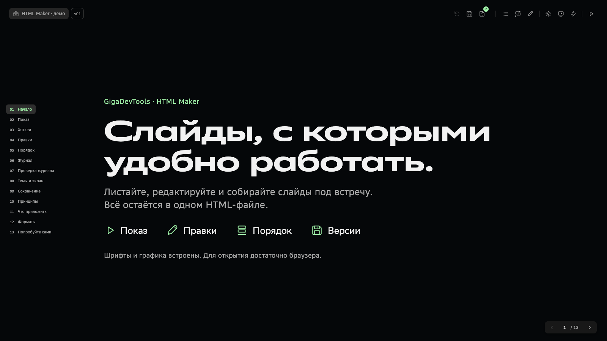

# GigaDevTools Slides

**Редактируемые HTML-презентации и перенос HTML в PowerPoint/PDF.**

Корпоративный пилот: два переносимых скилла и интерактивный пример оболочки.

[English](README.en.md) · [Открыть демо](https://design-sucks.github.io/gigadevtools-slides/) · [Скачать пакеты](https://github.com/design-sucks/gigadevtools-slides/releases) · [Быстрый старт](docs/quickstart.md)

| Скилл | Задача | Результат |
| --- | --- | --- |
| [HTML Maker](skills/gigadev-html-maker/SKILL.md) | PPTX или содержание → веб-презентация | Один редактируемый HTML |
| [HTML Export](skills/gigadev-html-export/SKILL.md) | HTML-презентация → другие форматы | Редактируемый PPTX или PDF для просмотра |

В оболочке есть свободная прокрутка, мягкие переходы, навигация клавиатурой/кликером, редактор текста и undo, порядок слайдов, журнал, сохранение версий и подготовленные темы. Оформление слайдов отделено от интерфейса. Это редактор текста, а не свободное перетаскивание объектов.

## Начать за три шага

1. Скачать ZIP нужного скилла из Releases или клонировать репозиторий.
2. Поместить соответствующий каталог skills в каталог скиллов своего клиента. Если регистрации скиллов нет, агент может прочитать SKILL.md и запустить скрипты.
3. Приложить материал и стилевой референс, вызвать $gigadev-html-maker либо $gigadev-html-export. Агенту нужны файлы и выполнение кода; обычный текстовый чат не выполнит конвертацию.

Пример запроса: «Используй $gigadev-html-maker. Собери из приложенной презентации редактируемый офлайн-HTML по стилевому референсу. Сохрани все тексты и числа, используй готовую оболочку, начни с v01 и проверь каждый слайд в браузере».

Для экспорта: «Используй $gigadev-html-export. Перенеси HTML в редактируемый PPTX, сохрани вёрстку, ссылки и шрифты. Укажи, что проверено в целевом PowerPoint».

[Установка и команды](docs/installation.md). После браузерных правок сохраняйте новую HTML-версию: именно она становится актуальным источником, а прежний deck.json автоматически не обновляется.

## Пример

[Демо оболочки](https://design-sucks.github.io/gigadevtools-slides/) можно открыть онлайн или скачать examples/shell-demo/index.html для локального просмотра. Шрифты и графика внутри файла. Базовая версия — **v01**, следующее сохранение — **v02**. На слайде 03 есть хоткеи: **N** — список, **M** — анимация. Кликеры, отправляющие PageUp/PageDown или стрелки, используют тот же путь навигации; физически все модели пультов не проверялись.

Отдельный кейс на исходном PPTX протестирован локально; частный материал в репозиторий не включён. Демо показывает функции оболочки. Качество дизайна новых слайдов всё ещё требует ручной визуальной оценки.

## Шрифты и лицензия

**Наш код и документация — MIT. SB Sans — сторонние шрифтовые ресурсы с отдельными условиями.** Пилот предназначен для корпоративного сценария; публикующая сторона сообщает о правах компании. Это не выдаёт всем посетителям лицензию на шрифт. OTF и встроенные в HTML копии исключены из MIT. См. [условия сторонних ресурсов](THIRD_PARTY_NOTICES.md). Для более широкого использования планируется отдельный проверенный профиль с открытыми шрифтами.

## Проверки и ограничения

Дизайн созданных слайдов пока требует визуальной доработки: плотность текста, длинные строки и неудачные переносы остаются слабыми местами. Набор эталонов и успешная проверка границ не гарантируют аккуратную типографику. [Как проверять текстовую вёрстку](skills/gigadev-html-maker/references/text-layout.md).

Принятая оболочка проверена в Chrome на Mac: 13 слайдов, обе темы, якоря контента, 208 остановочных состояний с анимацией/без неё, редактирование/undo, сохранение/повторное открытие, 16:9 в показе и экспортном адаптере. [Границы проверенного](docs/testing.md).

Необычные PPTX-эффекты требуют адаптации или растрового представления. HTML-скриншот не подтверждает точность PPTX. Для выдачи PowerPoint нужна проверка в целевой программе; Windows, Safari и другие клиенты проверяются отдельно. Конвертер использует профили и не обещает одинаковый результат для произвольного HTML.

[Как участвовать](CONTRIBUTING.md) · [Как выпускать обновления](docs/release-process.md) · [Совместимость](docs/compatibility.md) · [История](CHANGELOG.md).

Библиотека композиций 2.0.0: 24 утверждённых редактируемых эталона для Maker. Они задают сетку и типографическую иерархию; цвета и графика берутся из исходника или стилевого референса. [Выбор и обновление эталонов](skills/gigadev-html-maker/references/reference-pack.md). Прежний генератор 1.0.0 сохранён для совместимости с существующими проектами.
